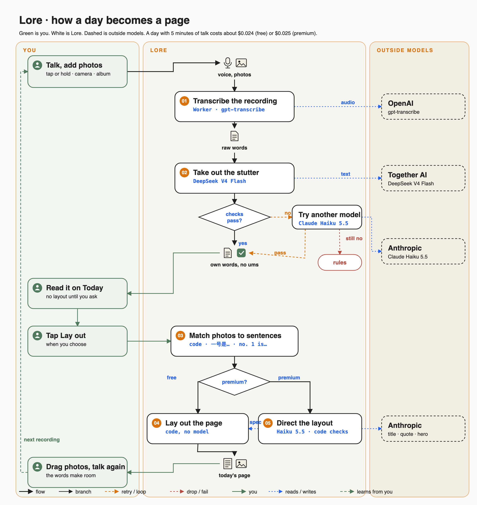

# Lore

Lore is a voice-first journal app. Users talk about their day, and Lore keeps their own words with the filler words removed and misheard words corrected. When the user taps Lay out, Lore sets the words and the day's photos as a page, with the text flowing around the photos.

The app is an Expo / React Native prototype. The model pipeline runs on a Cloudflare Worker. Entries are kept on the phone.



## How it works

1. **Show the words while the user talks.** In the installed app, Apple's speech recognition shows the words as they are said; where the phone supports it, recognition stays on the phone. The same microphone stream is saved as a 16 kHz WAV.
2. **Tidy each finished stretch.** At every pause, the stretch just finished goes to `/tidy`, and DeepSeek V4 Flash removes the filler words while the user keeps talking.
3. **Transcribe the recording.** When the user stops, the WAV goes to the backend, which sends it to OpenAI gpt-transcribe with a hint that the speaker mixes Mandarin and English. This is the transcript that is kept.
4. **Take out the stutter.** DeepSeek V4.1 Flash, with thinking off, removes:
   - fillers ("um", "嗯", "那个" used as a pause);
   - stutters;
   - false starts;
   - the half of a sentence the speaker took back.

   Everything else stays as it was said, including English inside Chinese, which is never translated. Code then sweeps out leftover filler sounds and checks the result. It must not lose English words, add Chinese characters or numbers, add formal connectives, or grow longer. If the check fails, Claude Haiku 5.5 tries once. If that also fails, a no-API rule set does the job.
5. **Fix misheard words and grammar.** A second call to DeepSeek V4.1 Flash corrects words the transcription clearly got wrong and, unless the user turns "Fix grammar" off, broken sentences, tenses and word order. Code checks that only a few words changed, every name is kept and no English inside Chinese was translated. With grammar off, DeepSeek V4 Flash corrects misheard words only. If the checks fail twice, the text is kept as it was.
6. **Match photos.** Users describe photos by number ("一号是…", "照片二…", "the picture one is…", "three to six are…"), at the start of a sentence or after a comma. Code splits the transcript into a part per photo or group.
7. **Lay out.**
   - **Free tier:** layout runs in code, with no model. Lines are broken in JavaScript around each photo's rectangle, using advance widths taken from the app's font files. Users can drag any photo, or drag one in from the tray, and the paragraphs reflow on every frame. A tap on a line opens its words for editing.
   - **Premium tier:** the layout director (Claude Haiku 5.5, structured output) picks a title, a template, a quote and a hero photo. Code checks that the title uses only the writer's words and that the quote appears in the text exactly.

   At Lay out, one call to DeepSeek V4 Flash also marks where the day moves to a new time ("下午", "after lunch"), and a small heading goes there in the speaker's own words; code checks that each heading appears in its sentence. Each stretch of talking keeps a voice bar at its top left; recordings stay in one bar while each starts within 20 minutes of the last one ending.

   Paragraphs follow rules rather than recordings (`app/src/paragraphs.ts`): about 3 to 6 lines, 7 at most. A longer recording is cut between sentences, preferably where the speaker turns to a new subject (a second DeepSeek V4 Flash call marks those); one under 2 lines joins its neighbour when no heading or photo stands between them. A paragraph that can't join anything stays short.

   A laid-out day can be laid out again. Older words then get the misheard-word and grammar fix once, and are matched to photos again.

## Choosing the models

The test set in `agent/eval/cases.json` has 24 recordings: 8 in Chinese, 8 in English and 8 mixed. Each one lists the phrases that must survive and the fillers that must go.

**Fix the stutter**, run twice per recording (48 runs):

| Model | Passed | Median latency | USD per 1,000 test recordings |
|---|---|---|---|
| **DeepSeek V4 Flash, thinking off** | **48/48** | 1.6 s | **0.05** |
| DeepSeek V4.1 Flash | 48/48 | 0.2 s | 0.13 |
| Claude Opus 5.5 (reference) | 48/48 | 1.1 s | 3.48 |
| Claude Haiku 5.5 | 46/48 | 0.8 s | 0.07 |
| No-API rules | 26/48 | — | 0 |

**Fix misheard words and grammar**: 16 cases, half that need a fix (a misheard word, a wrong tense, "的" for "得") and half that must stay as they are (clean sentences, a name, slang, dialect, Chinese with English in it), run twice per case (32 runs):

| Model | Passed | Median latency | USD per 1,000 test recordings |
|---|---|---|---|
| DeepSeek V4 Flash, thinking off | 32/32 | 2.2 s | 0.043 |
| Claude Haiku 5.5 | 32/32 | 0.8 s | 0.058 |
| **DeepSeek V4.1 Flash, thinking off** | 30/32 | **0.24 s** | 0.109 |

DeepSeek V4.1 Flash missed only with grammar turned off, when it still fixed a tense, so that setting uses DeepSeek V4 Flash. With grammar on, V4.1 Flash is used because it answers ten times faster. V4.1 Flash also passed all 48 tidy runs in about 0.2 s, so it does the tidy after the user stops; the stretches tidied while the user talks use the cheaper V4 Flash, since nobody waits for them.

**Transcription**, then the tidy step, on audio made from the same scripts with macOS system voices. Synthetic speech, so this ranks the options rather than settling the choice.

| Transcription | Raw error rate | English words kept | Final text passed | USD per minute, both steps |
|---|---|---|---|---|
| **OpenAI gpt-transcribe** | **2.4%** | **97%** | **21/24** | **0.0051** |
| OpenAI gpt-4o-mini-transcribe | 4.7% | 95% | 19/24 | 0.0036 |
| Together Whisper large-v3 | 6.4% | 95% | 19/24 | 0.0021 |

A day with five minutes of talk costs about $0.031 on the free tier and $0.032 on the premium tier, three quarters of it transcription. The full notes are in [`agent/ARCHITECTURE.md`](agent/ARCHITECTURE.md), written in Chinese.

## Layout of this repository

- **`app/`:** the Expo app. `src/Doc.tsx` holds the flowing-text layout, `src/Home.tsx` the writing page, `src/live.ts` Apple's live speech recognition, `src/store.ts` the entries kept on the phone, `src/agent.ts` the backend client and `src/match.ts` the photo matching.
- **`agent/`:** the model pipeline.
  - `core.mjs` holds the fix-the-stutter prompt, checks and rules; `fix.mjs` the fix-the-mishearing node.
  - `worker/` is the Cloudflare Worker.
  - `director.mjs` is the layout director.
  - `eval/` holds the test sets and comparison scripts, and `results/` the runs.

## Running it

The app runs in Expo Go, without live transcription:

```bash
cd app && npm install && npx expo start
```

It needs `app/.env` with `EXPO_PUBLIC_LORE_AGENT_URL` and `EXPO_PUBLIC_LORE_KEY`. Without them, it shows a demo transcript. Apple's live speech recognition needs a native build (`npx expo run:ios --device`).

The backend is a Cloudflare Worker:

```bash
cd agent/worker && npx wrangler deploy
```

Then set four secrets with `npx wrangler secret put`: `OPENAI_API_KEY`, `TOGETHER_API_KEY`, `ANTHROPIC_API_KEY` and `LORE_APP_KEY`.

To rerun the evaluations:

```bash
cd agent && npm install
node eval/run.mjs
node eval/stt.mjs
node eval/fix.mjs
```

They need API keys in the environment.
